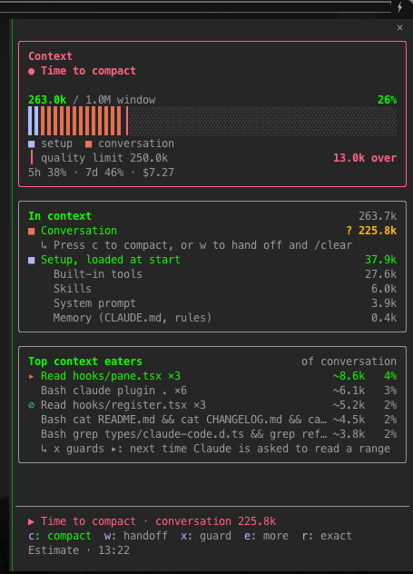

# cc-side-context

**See what is eating your Claude Code context, and fix it in one key.**

A [Claude Code](https://claude.com/claude-code) mod: a live side pane, and a one-row strip above the prompt, that show which tool outputs are filling your context window, when your prompt cache goes cold, and when a long conversation has started to lose track. When it is time to act, one key compacts while keeping your decisions, writes a handoff note for a fresh session, or guards the file that keeps eating your context so it does not happen again.



- **Which tool results fill the window**, biggest first: `Read package-lock.json ×3  ~6.1k  37%`, not just "Conversation".
- **Act on it:** `c` compacts with a keep-list (your rules, changed files, decisions, next step), `w` writes a handoff note, `x` guards the biggest eater so the next whole read of it is sent back once with advice to read a range.
- **Know when it costs you:** a prompt-cache countdown, and a quality budget that warns at 250k on a 1M window, long before auto-compact.

Local and MIT: nothing leaves your machine except the exact counts you ask for (see [Privacy](#how-the-numbers-are-made)).

## Install

```text
/plugin marketplace add bcanozgur/cc-side-context
/plugin install cc-side-context@cc-side-context
```

Restart Claude Code.

- **Terminal:** the pane docks beside the transcript with every new session when the terminal is at least 144 columns wide. In a narrower terminal, open it with `/side-context`; the strip above the prompt shows the context meanwhile.
- **Desktop app:** the strip above the prompt shows the context; **Details** opens the pane.

To update after a new release: `/plugin` → cc-side-context → update, then restart.

> **Requirements:** Claude Code **2.1.287** or newer in the terminal, **2.1.286** or newer in the desktop app. Mods ([function hooks](https://code.claude.com/docs/en/plugins/mods/overview)) are on by default from those versions; if you set `CLAUDE_CODE_ENABLE_FUNCTION_HOOKS` during the early access, you can remove it. Check with `claude --version`.

## Why

- `/context` tells you that *Conversation* is 320k tokens. It does not tell you that 60k of that is one `package-lock.json` you read three times.
- Compaction is lossy. The rules you gave early on, the files you changed and the approaches you rejected are often the first things the summary drops.
- On a 1M window, every message re-sends the whole conversation. Past a few hundred thousand tokens, each message costs a lot of your usage, and answers get worse well before auto-compact starts.
- The prompt cache expires: after an hour on a subscription within its limits, after 5 minutes on an API key or usage credits. After a long break, your next message pays to write the whole conversation into the cache again, and nothing tells you.

## What it shows

### The pane

```
● Healthy                                      +4.7k

56.3k / 1.0M window                               6%
█████████████┃░░░░░░░░░░░░░░░░░░░░░░░░░░░░░░░░░░░░░░
█████████████┃░░░░░░░░░░░░░░░░░░░░░░░░░░░░░░░░░░░░░░
■ setup  ■ conversation  ■ turn
┃ quality limit 250.0k                   193.7k left

cache 59m · 5h 49% · 7d 68% · $1.24

In context                                     54.6k
■ Conversation                                 16.3k
■ Setup, loaded at start                       38.3k
    Built-in tools                             27.6k
    Skills                                      6.0k
    System prompt                               4.7k

Top context eaters                   of conversation
▸ Read package-lock.json ×3               ~6.1k  37%
  github › get_issue                      ~3.4k  21%
⊘ Bash npm test                           ~2.3k  14%
  ↳ x guards ▸: next time Claude is asked to read a range

────────────────────────────────────────────────────
Nothing to do now
c: compact  w: handoff  x: guard  e: more
Estimate · 23:39
```

That is the terminal layout. The desktop app draws the same cards as a page: one fact per row, a colour per part, and a meter that magnifies under the pointer to name each part and its size.

| | |
| --- | --- |
| **Top context eaters** | The tool results still in your conversation, biggest first, each with its share of the conversation. Only calls over a hundredth of the budget (1k at least) get a row. Repeated reads of the same target are merged into one row, and shell commands are shown by what they did (`grep hooks/register.tsx`, not the `cd … &&` in front). `▸` marks the row `x` would guard. |
| **Next step** | One line above the buttons, read from the state: time to compact, rows to count exactly, a guard or a handoff while the context fills, or a past session to resume. Its button is drawn at full strength and the rest dim. |
| **The bar** | As long as the context window, split by what you can do about each part: **setup** (trimmed in settings), the **conversation** (what `c` and `w` act on) and the **turn** (what the latest turn added). `┃` marks the quality limit on a large window, otherwise auto-compact, and the line under it says how much room is left before the mark. |
| **In context** | The conversation first, as the part that grows; then what was loaded at the start (system prompt, tools, MCP, memory files, skills), biggest first. Live after every response, while a turn runs too. A row larger than usual is flagged, with a one-line fix. |
| **Prompt cache** | `cache 58m` counts down from the last reply. When the cache goes cold you get one warning, before your next message pays to write the whole conversation into it again. |
| **Limits and cost** | 5h and 7d usage on a subscription, and session cost on an API key. |
| **Grid view** | The same grid and category list that `/context` draws (⛁ ⛀ ⛶ ⛝). |

### The strip above the prompt

One row over the prompt with the verdict, the share of the window in use, the meter with the limit marked on it, and the room left. **Details** opens or closes the pane; **Compact** joins it once the context nears the limit. In the terminal, the strip steps aside while the pane is docked, where it would only repeat it.

## What it does

| Key | Command | Effect |
| --- | --- | --- |
| `c` | `/side-context compact` | **Compaction with a keep-list.** Tells the summary to keep your goal and rules word for word, every file changed, decisions and rejected approaches, open tasks and the next step. The same keep-list is also added to auto-compaction and your own `/compact` (turn this off with `smartCompact`). |
| `w` | `/side-context handoff` | **Handoff note.** Writes `.claude/side-context/handoff.md` from the transcript at no token cost: the goal, recent requests, open todos, files changed and read, and where it stopped. It also copies the line that starts a fresh session. The folder gets its own `.gitignore`, and the previous note is kept as `handoff.prev.md`. |
| `x` | `/side-context guards` | **Don't let it happen again.** Guards the biggest eater in this project: the next time the model reads that whole file, or runs that command without trimming its output, the call is sent back once with advice on how to make it smaller. If the model asks again, the call goes through. A guard that sends nothing back for 30 days is dropped, and `/side-context guards clear` removes them all. |
| `p` | | **Resume a past session.** Shown only in a new session, before your first message: this project's 5 latest sessions by name, and how long ago they ran. Press a number to continue one, the same as `/resume`. |
| | `/side-context stats` | **Session stats** to share: context now, turns, the peak, compactions and cold caches since launch, and how much of the tool output the top eaters took. Copied to the clipboard. |
| `s` | | Switch between the list and the `/context` grid (under **more**). |
| `e` | | Show the largest memory files, loaded MCP tools, skills, and the tools loaded on demand. |
| `r` | `/side-context full` | Recount exactly with the token-count API, as `/context` does (under **more**, or when a row is flagged). |
| | `/side-context` · `on` · `off` | Toggle, show or hide the pane. |
| | `/side-context help` | List the options. |

## What it changes in your session

A mod is code that runs with your permissions, so here is everything this one hooks, in full. `claude plugin validate .` lists the same from the source.

| Where | What it does |
| --- | --- |
| Every compaction | Adds the keep-list above to the summary's instructions, unless `smartCompact` is off. It never removes instructions you gave. |
| `Read` and `Bash` calls | Only for the guards you set with `x`: a whole read of a guarded file, or an untrimmed guarded command, is sent back **once** with advice. Asked again, it goes through. No guard, no effect. |
| Files | Writes only `.claude/side-context/` in the project (the handoff note, the one before it, and a `.gitignore`), and only when you ask for a handoff (`w`). |
| Network | None, except the exact counts (`r`, the grid), which go to the same token-count API `/context` uses. |
| Clipboard | The handoff's start line, `/side-context stats`, and `/compact` when compacting from the pane fails. |
| Commands | Runs `/resume` when you pick a past session, and `/compact` when compacting from the desktop app. |

## How it compares

[claude-hud](https://github.com/jarrodwatts/claude-hud) keeps a one-line status under your input. Other mods draw context too: [cctop](https://claude-mods.com/cctop/) is a full session dashboard (cost, limits, tool latency, subagents), [claude-mod-context-window](https://github.com/chrishan17/claude-mod-context-window) lists everything in the window by turn, kind, file and origin, and [context-pane](https://github.com/koprjaa/claude-code-context-bar) puts a context bar in the prompt footer. They are good at showing what is there.

cc-side-context is about acting on it: the eaters are ranked for the one you should do something about, and the keys compact with a keep-list, hand off to a fresh session, or guard the eater so it does not come back. It pairs well with a status-line HUD.

## Settings

Set in `/config` → plugin options, or with `claude plugin configure cc-side-context`.

| Option | Default | |
| --- | --- | --- |
| `qualityBudget` | `250000` | Warn and suggest compacting past this many tokens, when that is before auto-compact. `0` turns it off. |
| `smartCompact` | `true` | Add the keep-list to every compaction. |
| `cacheTtl` | `auto` | Cache lifetime for the countdown. `auto` follows Claude Code's own setting (`promptCacheTtl`, `CLAUDE_CODE_PROMPT_CACHE_TTL`, `FORCE_PROMPT_CACHING_5M`, `ENABLE_PROMPT_CACHING_1H`), and otherwise takes 1h on a subscription within its limits and 5m on an API key or usage credits. `5m` or `1h` sets it outright. |

## How the numbers are made

- **Estimate vs. exact.** After each response, the breakdown refreshes from a free local estimate. An estimate can only raise a question (`?`). Only an exact count (`r`, or the grid view) flags a row as too large (`*`). Exact counts send token-count requests, as `/context` does.
- **After `/clear` or `/resume`** the pane measures the new conversation at once. The cache countdown starts again at its first reply.
- **Top eaters** are sized from each tool result's text, so they read `~`: about 4 characters a token for English and code, 2 for accented and non-Latin text, 1 for CJK and emoji. After an exact count (`r`), the sizes are scaled to match it. Results that compaction has already summarized drop off the list.
- **Grid view** keeps `/context`'s exact count and recounts it at most once a minute while open.
- **Cache countdown** starts at the last main-thread response, with the lifetime from [Claude Code's prompt caching rules](https://code.claude.com/docs/en/prompt-caching). Subagents and compaction keep their own, shorter cache, which the countdown does not follow.
- **Privacy.** Nothing leaves your machine except the exact counts. The resume list reads the start and end of this project's transcripts in your Claude Code config directory, locally. Guards and each session's goal are kept in the plugin's own store under your Claude Code config directory.

## Troubleshooting

| | |
| --- | --- |
| The pane or the strip does not show | Check `claude --version` against the Requirements and restart after installing. In a terminal narrower than 144 columns, open the pane with `/side-context`. |
| `/side-context` is an unknown command | The mod did not load: your Claude Code is older than the Requirements, or the plugin is disabled in `/plugin`. |
| The pane says `Measuring…` | It shows the figures after the first reading. If it stays, send a message or run `/side-context on`. |
| A row is flagged `?` | That is an estimate raising a question. Press `r` for an exact count, which settles it (`*` or no flag). |
| The cache countdown is wrong | Set `cacheTtl` to `5m` or `1h` in the plugin options, and tell us your setup in an issue. |
| A guard keeps getting in the way | `/side-context guards` lists the guards, and `/side-context guards clear` removes them. The model can always repeat a call to get through. |

Something else? [Open an issue](https://github.com/bcanozgur/cc-side-context/issues) with your Claude Code version (`claude --version`) and, if you can, the output of `/side-context stats`.

## Uninstall

```text
/plugin uninstall cc-side-context@cc-side-context
```

You can also delete `.claude/side-context/` in projects where you wrote handoff notes.

## Develop

```text
hooks/register.tsx   the mod: commands, measuring, compaction, guards, handoff
hooks/analysis.ts    transcript analysis: eaters, sizes, command labels, guards, keep-list, handoff
hooks/pane.tsx       the pane in the terminal, in counted cells
hooks/pane-web.tsx   the pane on the page (desktop app and other surfaces), and the meter
hooks/strip.tsx      the strip above the prompt
types/index.d.ts     state contract and snapshot types
tests/               claude plugin test suite
```

```bash
claude plugin validate --strict .
claude plugin test .
claude --plugin-dir .   # load the working copy into a session
```

Contributions are welcome: see [CONTRIBUTING.md](CONTRIBUTING.md). [CHANGELOG.md](CHANGELOG.md) lists what changed in each release.

## License

[MIT](LICENSE)
