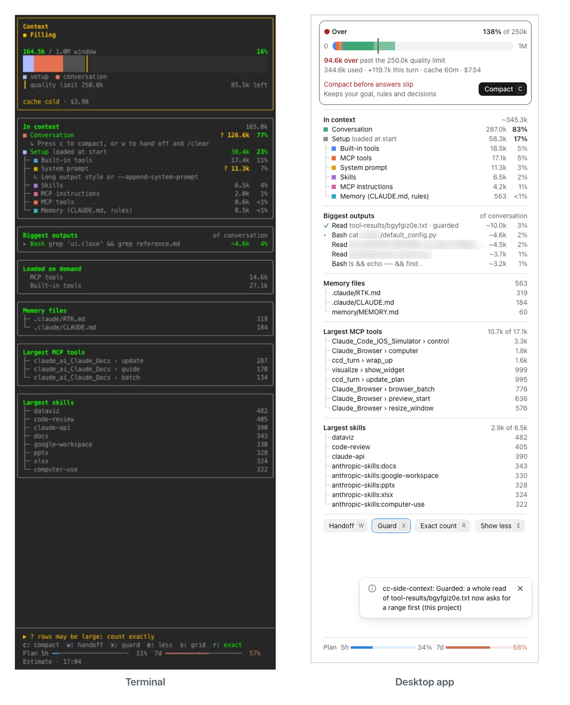
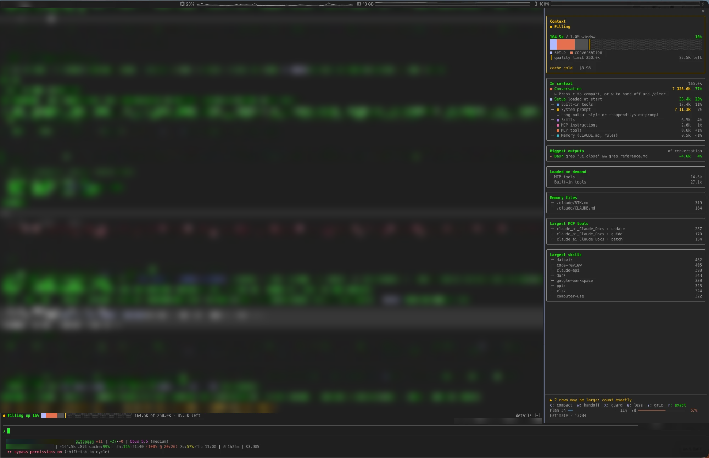
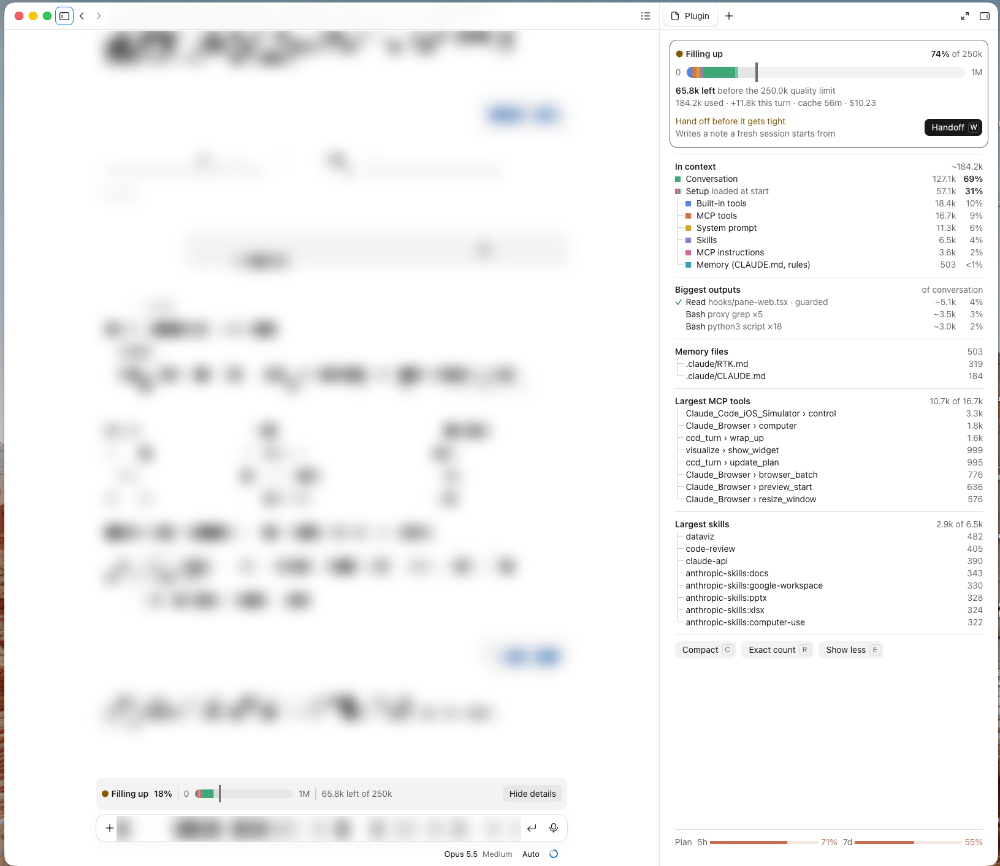

# cc-side-context

**See what is eating your Claude Code context, and fix it in one key.**

[](https://code.claude.com/docs/en/plugins/mods/overview) [](CHANGELOG.md) [](LICENSE)

A [Claude Code](https://claude.com/claude-code) mod with two parts. A live side pane shows which tool outputs fill your context window, when your prompt cache goes cold, and when a long conversation has started to lose track. A one-row strip above the prompt shows the same at a glance. When it is time to act, one key does it: compact while keeping your decisions, hand off to a fresh session, or guard the file that keeps eating your context.



- **See which outputs fill the window.** `/context` says "Conversation 320k". The pane says `Read package-lock.json ×3  ~60k  19%`.
- **Act on it in one key.** `c` compacts with a keep-list, `w` writes a handoff note, `x` stops the same output from coming back.
- **Know when it costs you.** A prompt-cache countdown, and a quality limit that warns at 250k on a 1M window, long before auto-compact.

Everything runs locally and the code is MIT-licensed. Nothing leaves your machine except the exact counts you ask for ([details](#privacy)).

## Install

```text
/plugin marketplace add bcanozgur/cc-side-context
/plugin install cc-side-context@cc-side-context
```

Then restart Claude Code.

| | |
| --- | --- |
| **Terminal** | The pane docks beside the transcript in every new session, if the terminal is at least 144 columns wide. In a narrower terminal, open it with `/side-context`; until then the strip above the prompt shows the context. |
| **Desktop app** | The strip above the prompt shows the context. **Details** opens the pane beside the chat. |

**Requirements:** Claude Code **2.1.287** or newer in the terminal, **2.1.286** or newer in the desktop app. Check yours with `claude --version`. Mods ([function hooks](https://code.claude.com/docs/en/plugins/mods/overview)) are on by default from those versions. If you set `CLAUDE_CODE_ENABLE_FUNCTION_HOOKS` during early access, you can remove it.

**Update:** run `/plugin`, choose cc-side-context, choose update, then restart.

## Why

- **`/context` stops at the category.** It tells you *Conversation* is 320k tokens. It does not tell you that 60k of that is one `package-lock.json` read three times.
- **Compaction is lossy.** The rules you gave early on, the files you changed and the approaches you rejected are often the first things a summary drops.
- **Long conversations get expensive and worse.** On a 1M window, every message re-sends the whole conversation. Past a few hundred thousand tokens, each message costs a lot of your usage, and answers get worse well before auto-compact starts.
- **The prompt cache expires silently.** It lasts an hour on a subscription within its limits, and 5 minutes on an API key or usage credits. After a long break, your next message pays to write the whole conversation back into the cache, and nothing tells you.

## What it shows

### In the terminal

The pane docks beside the transcript, and the strip sits above the prompt.



### In the desktop app

The strip sits above the prompt, and **Details** opens the pane beside the chat.



### The pane, section by section

| Section | What it tells you |
| --- | --- |
| **Summary** | A verdict (Healthy, Filling up, Time to compact) and how much of the limit is used. Below that: a meter of the whole window with the limit marked on it, the room left, and this session's figures: tokens used, the cache countdown, cost. When something needs doing, the next step with its button. |
| **In context** | The conversation first, since it is the part that grows. Then what was loaded at the start, under one **Setup** sum: system prompt, tools, MCP, memory files, skills. Each row shows its size and share. Updates after every response, and while a turn runs. A row larger than usual is flagged, with a one-line fix. |
| **Biggest outputs** | The tool results still in your conversation, biggest first, each with its share. Repeated reads of the same target merge into one row. A shell command is labeled by what it did (`grep hooks/register.tsx`), without the `cd … &&` in front. `▸` marks the row `x` would guard, and `✓` marks one already guarded. |
| **Plan** | Your 5-hour and 7-day usage as bars at the foot of the pane: blue, orange from 50%, red from 80%. Shown on a subscription, once the first response of the session reports them. |
| **Show all** | `e` adds the largest memory files, MCP tools and skills, each list drawn from its part of **In context**. |
| **Grid** | `s` (terminal) switches to the same grid and category list `/context` draws. |

### The strip

A single row above the prompt. It shows the verdict, the share of the window in use, the meter with the limit marked, and the room left. **Details** opens or closes the pane, and **Compact** appears there once the context nears the limit. In the terminal, the strip hides while the pane is docked, so it does not repeat what the pane already shows.

## What it does

| Key | Command | Effect |
| --- | --- | --- |
| `c` | `/side-context compact` | **Compact with a keep-list.** The summary is told to keep your goal and rules word for word, every changed file, decisions and rejected approaches, open tasks, and the next step. The same keep-list also goes into auto-compaction and your own `/compact`. Turn this off with `smartCompact`. |
| `w` | `/side-context handoff` | **Write a handoff note.** Writes `.claude/side-context/handoff.md` from the transcript, at no token cost: the goal, recent requests, open todos, files changed and read, and where the work stopped. The line that starts a fresh session from the note is copied to your clipboard. The previous note is kept as `handoff.prev.md`, and the folder gets its own `.gitignore`. |
| `x` | `/side-context guards` | **Stop it happening again.** Guards the biggest output in this project. The next time Claude reads that whole file, or runs that command without trimming its output, the call is sent back once with advice on how to make it smaller. If Claude asks again, the call goes through. A guard that sends nothing back for 30 days is dropped, and `/side-context guards clear` removes them all. |
| `p` | | **Resume a past session.** Only in a new session, before your first message: lists this project's 5 latest sessions by name and how long ago they ran. Press a number to continue one, as `/resume` would. |
| `r` | `/side-context full` | **Count exactly** with the token-count API, as `/context` does. |
| `e` | | **Show all** or **show less**. |
| | `/side-context stats` | **Copy session stats** to share: the context now, turns, the peak, compactions and cold caches since launch, and how much of the tool output the biggest outputs took. |
| | `/side-context` · `on` · `off` | Toggle, show or hide the pane. |
| | `/side-context help` | List the options. |

## What it changes in your session

A mod is code that runs with your permissions, so here is everything this one touches. `claude plugin validate .` lists the same hooks from the source.

| Where | What it does |
| --- | --- |
| Compaction | Adds the keep-list to the summary's instructions, unless `smartCompact` is off. It never removes instructions you gave. |
| `Read` and `Bash` calls | Acts only on guards you set with `x`. A whole read of a guarded file, or an untrimmed guarded command, is sent back **once** with advice. Asked again, it goes through. With no guards set, it does nothing. |
| Files | Writes only to `.claude/side-context/` in the project: the handoff note, the one before it, and a `.gitignore`. It writes only when you ask for a handoff with `w`. |
| Network | Nothing, except the exact counts (`r`, the grid), which use the same token-count API as `/context`. |
| Clipboard | The handoff's start line, `/side-context stats`, and `/compact` when compacting from the pane fails. |
| Commands | Runs `/resume` when you pick a past session, and `/compact` when you compact from the desktop app. |

## How it compares

[claude-hud](https://github.com/jarrodwatts/claude-hud) keeps a one-line status under your input. Other mods draw context too:

- [cctop](https://claude-mods.com/cctop/) is a full session dashboard: cost, limits, tool latency, subagents.
- [claude-mod-context-window](https://github.com/chrishan17/claude-mod-context-window) lists everything in the window by turn, kind, file and origin.
- [context-pane](https://github.com/koprjaa/claude-code-context-bar) puts a context bar in the prompt footer.

They are good at showing what is there. cc-side-context is about acting on it. The outputs are ranked so the one worth acting on comes first, and the keys compact with a keep-list, hand off to a fresh session, or guard the output so it does not come back. It pairs well with a status-line HUD.

## Settings

Set these in `/config` under plugin options, or with `claude plugin configure cc-side-context`.

| Option | Default | |
| --- | --- | --- |
| `qualityBudget` | `250000` | Past this many tokens, the pane warns and suggests compacting, if that comes before auto-compact. `0` turns it off. |
| `smartCompact` | `true` | Add the keep-list to every compaction. |
| `cacheTtl` | `auto` | Cache lifetime for the countdown. `auto` follows Claude Code's own setting (`promptCacheTtl`, `CLAUDE_CODE_PROMPT_CACHE_TTL`, `FORCE_PROMPT_CACHING_5M`, `ENABLE_PROMPT_CACHING_1H`). With none of those set, it uses 1h on a subscription within its limits and 5m on an API key or usage credits. `5m` or `1h` sets it directly. |

## How the numbers are made

- **Estimate or exact.** After each response, the breakdown refreshes from a free local estimate. An estimate can only raise a question (`?`); only an exact count (`r`, or the grid) flags a row as too large (`*`). Exact counts send token-count requests, as `/context` does.
- **Biggest outputs** are sized from each tool result's text, so they read `~`: about 4 characters per token for English and code, 2 for accented and non-Latin text, and 1 for CJK and emoji. After an exact count, the sizes are scaled to match it. Results that compaction has already summarized drop off the list.
- **After `/clear` or `/resume`**, the pane measures the new conversation at once. The cache countdown starts again at the first reply.
- **The grid** keeps `/context`'s exact count and recounts at most once a minute while it is open.
- **The cache countdown** starts at the last main-thread response and uses the lifetime from [Claude Code's prompt caching rules](https://code.claude.com/docs/en/prompt-caching). Subagents and compaction keep their own, shorter caches, which the countdown does not follow.

### Privacy

Nothing leaves your machine except the exact counts. The resume list reads the start and end of this project's transcripts in your Claude Code config directory, locally. Guards and each session's goal are kept in the plugin's own store, under your Claude Code config directory.

## Troubleshooting

| Problem | What to do |
| --- | --- |
| The pane or the strip does not show | Check `claude --version` against the Requirements, and restart after installing. In a terminal narrower than 144 columns, open the pane with `/side-context`. |
| `/side-context` is an unknown command | The mod did not load. Your Claude Code is older than the Requirements, or the plugin is disabled in `/plugin`. |
| The pane says `Measuring…` | The figures appear after the first reading. If it stays, send a message or run `/side-context on`. |
| The Plan bars are missing | Claude Code reports 5h and 7d usage only with a response, and only on a subscription. Send a message. |
| A row is flagged `?` | An estimate is raising a question. Press `r` for an exact count, which either confirms it (`*`) or clears the flag. |
| The cache countdown is wrong | Set `cacheTtl` to `5m` or `1h`, and tell us your setup in an issue. |
| A guard gets in the way | `/side-context guards` lists them and `/side-context guards clear` removes them. Claude can always repeat a call to get through. |

Something else? [Open an issue](https://github.com/bcanozgur/cc-side-context/issues) with your Claude Code version (`claude --version`) and, if you can, the output of `/side-context stats`.

## Uninstall

```text
/plugin uninstall cc-side-context@cc-side-context
```

In projects where you wrote handoff notes, you can also delete `.claude/side-context/`.

## Develop

```text
hooks/register.tsx   the mod: commands, measuring, compaction, guards, handoff
hooks/analysis.ts    transcript analysis: outputs, sizes, command labels, guards, keep-list, handoff
hooks/pane.tsx       the pane in the terminal, in counted cells
hooks/pane-web.tsx   the pane on the page (desktop app and other surfaces), and the meter
hooks/strip.tsx      the strip above the prompt
types/index.d.ts     state contract and snapshot types
tests/               claude plugin test suite
```

```bash
claude plugin validate --strict .
claude plugin test .
claude --plugin-dir .   # load the working copy into a session
```

Contributions are welcome: see [CONTRIBUTING.md](CONTRIBUTING.md). [CHANGELOG.md](CHANGELOG.md) lists what changed in each release.

## License

[MIT](LICENSE)
