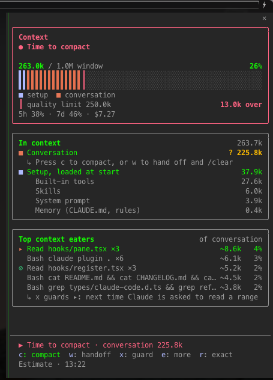

# cc-side-context

**See what is eating your Claude Code context, and fix it in one key.**

A live side pane for [Claude Code](https://claude.com/claude-code). It shows which tool outputs are filling your context window, when your prompt cache goes cold, and when a long conversation has started to lose track. When it is time to act, one key compacts while keeping your decisions, or writes a handoff note for a fresh session.



## Why

- `/context` tells you that *Conversation* is 320k tokens. It does not tell you that 60k of that is one `package-lock.json` you read three times.
- Compaction is lossy. The rules you gave early on, the files you changed and the approaches you rejected are often the first things the summary drops.
- On a 1M window, every message re-sends the whole conversation. Past a few hundred thousand tokens, each message costs a lot of your usage, and answers get worse well before auto-compact starts.
- The prompt cache expires after 5 minutes on an API key (1 hour on a subscription). After a coffee break, your next message pays to write the whole conversation into the cache again, and nothing tells you.

## What it shows

```
● Healthy                                      +4.7k

56.3k / 1.0M window                               6%
█████████████┃░░░░░░░░░░░░░░░░░░░░░░░░░░░░░░░░░░░░░░
█████████████┃░░░░░░░░░░░░░░░░░░░░░░░░░░░░░░░░░░░░░░
■ setup  ■ conversation  ■ turn
┃ quality limit 250.0k                   193.7k left

cache 59m · 5h 49% · 7d 68% · $1.24

In context                                     54.6k
■ Conversation                                 16.3k
■ Setup, loaded at start                       38.3k
    Built-in tools                             27.6k
    Skills                                      6.0k
    System prompt                               4.7k

Top context eaters                   of conversation
▸ Read package-lock.json ×3               ~6.1k  37%
  github › get_issue                      ~3.4k  21%
⊘ Bash npm test                           ~2.3k  14%
  ↳ x guards ▸: next time Claude is asked to read a range

────────────────────────────────────────────────────
Nothing to do now
c: compact  w: handoff  x: guard  e: more
Estimate · 23:39
```

| | |
| --- | --- |
| **Top context eaters** | The tool results still in your conversation, biggest first, each with its share of the conversation. Only calls over a hundredth of the budget (1k at least) get a row. Repeated reads of the same target are merged into one row, and shell commands are shown by what they did (`grep hooks/register.tsx`, not the `cd … &&` in front; every command of a chain, `ls && git diff`). `▸` marks the row `x` would guard, and the line under the list says what that does; with nothing to guard, it is a tip on how to keep the biggest one smaller. |
| **Next step** | One line above the buttons, read from the state: time to compact, rows to count exactly, a guard or a handoff while the context fills, or a past session to resume in a new one. Its button is drawn at full strength and the rest dim. |
| **The bar** | One bar as long as the context window, so its end is the window's end (1.0M on a 1M model). It is split by what you can do about each part: **setup**, trimmed in settings; the **conversation**, which `c` and `w` act on; and the **turn**, what the latest turn added, at the growing end, the same as the `+` figure. `┃` marks where the pane warns: the quality limit on a large window, otherwise auto-compact. The track up to it is the room you have, the pale `░` past it is window you should not need, and the line under the key says how much is left before the mark, or how far past it the context is. The percent is of the window, as Claude Code's status line counts it; the status and the mark's colour are of the limit. |
| **Per-category breakdown** | The conversation first, as the part that grows; then what was loaded at the start (system prompt, tools, MCP, memory files, skills) under its sum, each part beneath it, biggest first. The marks are the bar's colours. Live after every response, while a turn runs too. A row that is larger than usual is flagged, with a one-line fix under it. |
| **Prompt cache** | `cache 58m` counts down from the last reply. When the cache goes cold you get one warning, before your next message pays to write the whole conversation into it again. |
| **Limits and cost** | 5h and 7d usage on a subscription, and session cost on an API key. |
| **Quality limit** | On large windows the pane marks 250k tokens (configurable) on the bar and warns there, long before auto-compact would start. |
| **Grid view** | The same grid and category list that `/context` draws (⛁ ⛀ ⛶ ⛝). |

## What it does

| Key | Command | Effect |
| --- | --- | --- |
| `c` | `/side-context compact` | **Compaction with a keep-list.** Tells the summary to keep your goal and rules word for word, every file changed, decisions and rejected approaches, open tasks and the next step. The same keep-list is also added to auto-compaction and to your own `/compact`. The pane shows `◌ Compacting` while the summary is written. |
| `w` | `/side-context handoff` | **Handoff note.** Writes `.claude/side-context/handoff.md` from the transcript at no token cost: the goal, recent requests, open todos, files changed and read, and where it stopped. It also copies the line that starts a fresh session. The goal survives compactions. The folder gets its own `.gitignore`, and the previous note is kept as `handoff.prev.md`. |
| `x` | `/side-context guards` | **Don't let it happen again.** Guards the biggest eater in this project: the next time the model reads that whole file, or runs that command without trimming its output, the call is sent back once with advice on how to make it smaller. If the model asks again, the call goes through. `▸` marks the row it would guard and `⊘` the guarded ones; with nothing to guard, the button stays in place, dim. A guard that sends nothing back for 30 days is dropped, and `/side-context guards clear` removes them all. |
| `p` | | **Resume a past session.** Shown only in a new session, before your first message. It lists this project's 5 latest sessions by name (the `/rename` name, Claude's title, or the first prompt) and how long ago they ran. Press a number to continue one, the same as `/resume`. Once the conversation starts, the button goes away. |
| | `/side-context stats` | **Session stats** to share: context now, turns, the peak, compactions and cold caches since launch, and how much of the tool output the top eaters took. Copied to the clipboard. |
| `s` | | Switch between the list and the `/context` grid (under **more**). |
| `e` | | Show the largest memory files, loaded MCP tools, skills, and the tools loaded on demand. |
| `r` | `/side-context full` | Recount exactly with the token-count API, as `/context` does (under **more**, or when a row is flagged). |
| | `/side-context` · `on` · `off` | Toggle, show or hide the pane. |
| | `/side-context help` | List the options. |

## Install

```text
/plugin marketplace add bcanozgur/cc-side-context
/plugin install cc-side-context@cc-side-context
```

Restart Claude Code. The pane opens with every new session when the terminal is at least 144 columns wide. In a narrower terminal, open it with `/side-context`.

To update after a new release: `/plugin` → cc-side-context → update, then restart.

> **Requirements:** Claude Code 2.1.29x or newer, with function hooks (plugin `hooks/register.tsx` modules). That API is in early access and may change between releases.

### Works with claude-hud

[claude-hud](https://github.com/jarrodwatts/claude-hud) keeps a one-line status under your input. This pane shows *why* the number is what it is, and what to do about it. Use both.

| | `/context` | status line HUDs | **cc-side-context** |
| --- | :-: | :-: | :-: |
| Total and per-category usage | ✓ (on demand) | total | ✓ live |
| Which tool results fill the window | | | ✓ |
| Prompt cache countdown and cold warning | | ✓ | ✓ |
| Compaction that keeps decisions and files | | | ✓ |
| Handoff note for a fresh session | | | ✓ |
| Guard against the same big read next time | | | ✓ |
| Quality budget below auto-compact | | | ✓ |

## Settings

Set in `/config` → plugin options, or with `claude plugin configure cc-side-context`.

| Option | Default | |
| --- | --- | --- |
| `qualityBudget` | `250000` | Warn and suggest compacting past this many tokens, when that is before auto-compact. `0` turns it off. |
| `smartCompact` | `true` | Add the keep-list to every compaction. |
| `cacheTtl` | `auto` | Cache lifetime for the countdown: `auto` (1h on a subscription, 5m on an API key), `5m` or `1h`. |

## How the numbers are made

- **Estimate vs. exact.** After each response, the breakdown refreshes from a free local estimate. An estimate can only raise a question (`?`). Only an exact count (`r`, or the storage view) flags a row as too large (`*`). Exact counts send token-count requests, as `/context` does.
- **After `/clear` or `/resume`** the pane measures the new conversation at once. The cache countdown starts again at its first reply.
- **Top eaters** are sized from each tool result's text, so they read `~`: about 4 characters a token for English and code, 2 for accented and non-Latin text, 1 for CJK and emoji. After an exact count (`r`), the sizes are scaled to match it. Results that compaction has already summarized drop off the list.
- **Grid view** keeps `/context`'s exact count and recounts it at most once a minute while open.
- **Cache countdown** starts at the last main-thread response. The 5m/1h guess can be wrong for your setup: set `cacheTtl` if it is.
- **Privacy.** Nothing leaves your machine except the exact counts, which go to the same token-count API that `/context` uses. The only files the plugin writes are in `.claude/side-context/` (the handoff note, the one before it, and a `.gitignore` that keeps them out of git). The resume list reads the start and end of this project's transcripts in your Claude Code config directory, locally. Guards and each session's goal are kept in the plugin's own store under your Claude Code config directory.

## Troubleshooting

| | |
| --- | --- |
| The pane does not open | Your terminal may be narrower than 144 columns. Open it with `/side-context`. If the command is unknown, check that your Claude Code build has function hooks (see Requirements) and that you restarted after installing. |
| The pane says `Measuring…` | It shows the figures after the first reading. If it stays, send a message or run `/side-context on`. |
| A row is flagged `?` | That is an estimate raising a question. Press `r` for an exact count, which settles it (`*` or no flag). |
| The cache countdown is wrong | Set `cacheTtl` to `5m` or `1h` in the plugin options. |
| A guard keeps getting in the way | `/side-context guards` lists the guards, and `/side-context guards clear` removes them. The model can always repeat a call to get through. |

Something else? [Open an issue](https://github.com/bcanozgur/cc-side-context/issues) with your Claude Code version (`claude --version`) and, if you can, the output of `/side-context stats`.

## Uninstall

```text
/plugin uninstall cc-side-context@cc-side-context
```

You can also delete `.claude/side-context/` in projects where you wrote handoff notes.

## Develop

```text
hooks/register.tsx   the hooks module: commands, measuring, compaction, guards, handoff
hooks/pane.tsx       drawing the pane
hooks/analysis.ts    transcript analysis: eaters, sizes, command labels, guards, keep-list, handoff
types/index.d.ts     state contract and snapshot types
tests/               claude plugin test suite
```

```bash
claude plugin validate --strict .
claude plugin test .
claude --plugin-dir .   # load the working copy into a session
```

See [CHANGELOG.md](CHANGELOG.md) for what changed in each release.

## License

[MIT](LICENSE)
